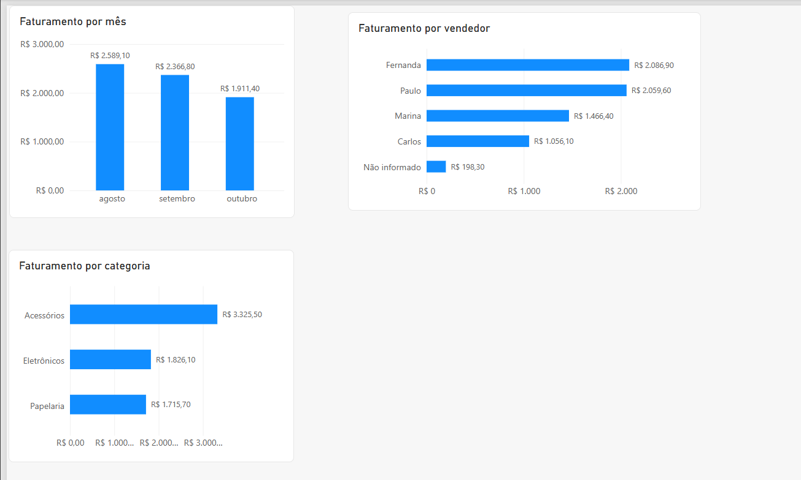

# Mini projeto ETL: vendas da Papelaria Ponto Certo

Projeto de estudo que simula um caso real de análise de dados: a gerente de uma papelaria pede três respostas de negócio e entrega um arquivo exportado do sistema antigo, cheio de problemas de qualidade.

> **Todos os dados deste projeto são fictícios**, criados apenas para estudo.

O foco do projeto **não é o painel**. O objetivo foi praticar o **ETL**, principalmente a etapa de **transformação**, e a capacidade de entregar dados íntegros que respondam à demanda do negócio. Por isso o Power BI foi usado de forma simples, só para validar e apresentar o resultado.



## A demanda

A gerente, Dona Marta, pediu uma análise das vendas de **agosto a outubro de 2026**:

1. Quanto faturamos por mês?
2. Quais categorias vendem mais?
3. Quais vendedores estão trazendo mais resultado?

## Fluxo

```
vendas_bruto.csv  ->  Python (Pandas)  ->  SQLite  ->  Power BI
     Extract            Transform          Load         Painel
```

| Etapa | O que faz |
|---|---|
| **Extract** | Lê o CSV bruto (84 registros) |
| **Transform** | Limpa e padroniza os dados (resultado: 73 vendas) |
| **Load** | Grava a tabela `vendas` em um banco SQLite (`data/processed/vendas.db`) |
| **BI** | O Power BI lê o banco e mostra três visuais que respondem à demanda |

**Tecnologias:** Python, Pandas, SQLite e Power BI Desktop.

## Estrutura do repositório

```
mini-projeto-etl-vendas/
├── data/
│   ├── raw/
│   │   └── vendas_bruto.csv      # arquivo bruto (fonte)
│   └── processed/
│       └── vendas.db             # gerado pelo ETL (fora do Git)
├── docs/
│   └── painel.png                # captura do painel
├── etl.py                        # extrair, transformar e carregar
├── dash_vendas.pbix              # painel do Power BI
├── .gitignore
└── README.md
```

## Problemas de qualidade encontrados e decisões tomadas

O arquivo bruto foi criado com problemas propositais, comuns em dados reais:

| Problema | Onde | O que foi feito |
|---|---|---|
| Vendas duplicadas (4) | Linhas inteiras | Removidas pelo `id_venda`, mantendo a primeira ocorrência |
| Datas em 3 formatos | `data_venda` | Convertidas lendo cada formato com a ordem declarada (ano-mês-dia, dia/mês/ano e dia-mês-ano) |
| Espaços extras | `cliente`, `produto`, `vendedor` | Removidos (por exemplo, `cliente` passou de 17 para 12 valores distintos) |
| Caixa inconsistente | `vendedor`, `categoria`, `forma_pagamento` | Padronizada (por exemplo, `vendedor` passou de 8 para 4 valores distintos) |
| Nulos em `cliente` e `vendedor` | 3 e 5 registros no arquivo bruto | Preenchidos com o rótulo `Não informado`, porque não entram no cálculo do faturamento |
| Nulos em `quantidade` e `preco_unitario` | 4 e 3 registros | Registros removidos, porque sem esses campos o valor da venda não pode ser calculado |
| `quantidade` como decimal | Consequência dos nulos | Convertida para inteiro depois da remoção dos nulos |

**Regra adotada para nulos:** se a coluna é necessária para calcular o faturamento, a linha é removida. Se não é, o valor é preenchido com um rótulo, sem inventar dados.

Resultado: **84 registros brutos viraram 73 vendas** (4 duplicadas e 7 sem quantidade ou preço removidas).

## Resultados

Faturamento total do período: **R$ 6.867,30**, em 73 vendas.

| Mês | Faturamento |
|---|---|
| Agosto | R$ 2.589,10 |
| Setembro | R$ 2.366,80 |
| Outubro | R$ 1.911,40 |

| Categoria | Faturamento | Nº de vendas |
|---|---|---|
| Acessórios | R$ 3.325,50 | 13 |
| Eletrônicos | R$ 1.826,10 | 12 |
| Papelaria | R$ 1.715,70 | 48 |

| Vendedor | Faturamento |
|---|---|
| Fernanda | R$ 2.086,90 |
| Paulo | R$ 2.059,60 |
| Marina | R$ 1.466,40 |
| Carlos | R$ 1.056,10 |
| Não informado | R$ 198,30 |

Principais leituras:

- Agosto foi o melhor mês, mas três meses de dados são pouco para falar em tendência.
- Acessórios lidera em faturamento. A Papelaria tem mais vendas, mas o menor faturamento, porque seus produtos são mais baratos.
- Fernanda e Paulo estão praticamente empatados (diferença de R$ 27,30, cerca de 1,3%).

## Validações feitas

Cada etapa foi conferida antes de seguir para a próxima:

- `nunique()` das colunas de texto, antes e depois da limpeza, para provar que as variações sumiram.
- `duplicated().sum()` igual a 0, na tabela inteira e no `id_venda`.
- Tipo de `data_venda` como data, sem valores vazios, com mínima em 02/08/2026 e máxima em 30/10/2026.
- ETL executado duas vezes, e o banco continua com 73 linhas (a carga usa `if_exists="replace"`).
- Soma do faturamento no banco igual à soma no Power BI (R$ 6.867,30).

### Um erro que a validação encontrou

Ao importar os dados no Power BI, os preços vieram **10 vezes maiores** (4,5 virou 45). A causa foi a configuração regional em português: o ponto decimal foi lido como separador de milhar. Os valores de quantidade e as datas estavam corretos, e só a conferência do faturamento total mostrou o problema. A correção foi indicar a localidade `en-US` no passo de alteração de tipo do Power Query.

## Como executar

1. Clone o repositório e entre na pasta do projeto.
2. Crie e ative um ambiente virtual, e instale o Pandas:

```
python -m venv .venv
.venv\Scripts\activate
pip install pandas
```

3. Rode o ETL:

```
python etl.py
```

O comando lê `data/raw/vendas_bruto.csv` e cria `data/processed/vendas.db` com a tabela `vendas`. Pode ser executado várias vezes sem duplicar os dados.

## Conectando ao Power BI

1. No Power BI Desktop, configure o Python em **Arquivo > Opções e configurações > Opções > Script do Python**, apontando para a pasta do `python.exe` que tem `pandas` e `matplotlib` instalados.
2. Use **Obter dados > Outros > Script do Python** com um script que lê a tabela `vendas`:

```python
import sqlite3
import pandas as pd

caminho = r"C:\caminho\do\projeto\data\processed\vendas.db"

conexao = sqlite3.connect(caminho)
try:
    vendas = pd.read_sql("SELECT * FROM vendas", conexao)
finally:
    conexao.close()
```

3. Em **Transformar dados**, edite o passo `Tipo Alterado` e acrescente a localidade `"en-US"` ao final da função `Table.TransformColumnTypes`, para que os preços sejam lidos corretamente.
4. Crie a coluna calculada `Faturamento = vendas[quantidade] * vendas[preco_unitario]` e monte os visuais.

## Limitações

- O script do Power BI usa um **caminho absoluto**, então é preciso ajustá-lo em outra máquina.
- São só **três meses** de dados, e as 7 vendas removidas por falta de quantidade ou preço fazem o faturamento real ser um pouco maior que o informado.
- O arquivo é pequeno e fictício, pensado para estudo.
- O painel é simples de propósito, porque o foco foi a qualidade dos dados.

## Próximos passos

- Corrigir os lançamentos incompletos na origem, em um caso real.
- Recuperar o preço das vendas sem preço a partir do mesmo produto em outras vendas.
- Parametrizar os caminhos dos arquivos.

## Autor

**João** | [LinkedIn](https://www.linkedin.com/) | [GitHub](https://github.com/)